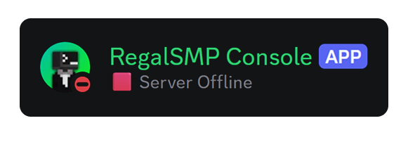

<div align="center">

  <picture>
    <source srcset="assets/logo/logo-dark.svg" media="(prefers-color-scheme: dark)">
    <source srcset="assets/logo/logo-light.svg" media="(prefers-color-scheme: light)">
    
  </picture>

  <h4>
    CraftDaemon is a lightweight Discord-native control panel for self-hosted Minecraft servers<br>
    built around systemd, RCON, and Linux-native workflows, without requiring a web dashboard.
  </h4>

  <a href="https://nodejs.org" target="_blank"></a>&nbsp;
  <a href="https://discord.js.org" target="_blank"></a>&nbsp;
  <a href="https://systemd.io" target="_blank"></a>&nbsp;
  <a href="https://papermc.io" target="_blank"></a>&nbsp;
  <a href="https://github.com/d1vid3d/CraftDaemon" target="_blank"></a>&nbsp;
  <a href="https://github.com/d1vid3d/CraftDaemon/releases" target="_blank"></a>

</div>

---

## Overview

CraftDaemon gives you Discord slash commands to start, stop, restart, monitor, execute console commands, and stream live logs, all from Discord. Instead of SSH-ing in or keeping a terminal open, you interact with the server entirely from Discord.

It works by sitting alongside your Minecraft server on the same host, both running as **systemd services**. The bot controls the server by calling `systemctl` commands, and reads live stats (TPS, player list, RCON latency) by talking directly to the server over **RCON**.

### How it works at a glance

```
Discord User
     │
     │  slash command (/start, /stop, /status, /exec, /logs…)
     ▼
CraftDaemon Bot  ──── systemctl start/stop/restart ────▶  Minecraft systemd service
  (systemd)      ◀─── RCON (127.0.0.1:25575) ──────────  (Minecraft Server)
```

Two systemd services run on your host:

| Service | What it is |
|---|---|
| `craftdaemon` (or your chosen name) | The Discord bot itself |
| `minecraft` (or your chosen name) | Your Minecraft server |

The bot does **not** spawn the Minecraft process itself, it delegates entirely to systemd. This means clean startup/shutdown handling, proper logging via `journald`, and automatic restarts on failure, all without the bot being in the middle of the process tree.

> **Paper is the tested target.** CraftDaemon is developed and run against Paper in production, and Paper is the de facto standard for self-hosted servers. TPS reporting relies on Paper's `tps` command, which vanilla does not provide.
>
> Other server types still work: lifecycle, RCON, logs, and player tracking use the standard protocol, and only status detail changes. `SERVER_TYPE` controls how TPS is reported. `PAPER` queries `tps`, an empty value shows *(Not Set)*, and any other value shows *(Not Supported)*. The variable exists as groundwork for fuller server-specific support later.

### Documentation

> ⚠️ **The website is under maintenance.** Its documentation is being brought back in line with the current code, so parts of it may be outdated or describe behaviour that has changed.
>
> Until that work is complete, **this README is the canonical documentation**. The website becomes canonical again once it matches the current release.

---

## Features

### Slash commands

| Command | Description |
|---|---|
| `/start` | Starts the Minecraft server via `systemctl start` |
| `/stop` | Stops the server via `systemctl stop` |
| `/restart` | Restarts the server via `systemctl restart` |
| `/logs` | Stream live logs, fetch tail snapshots, or download the server log file (`live`, `tail`, `download`, `stop` subcommands) |
| `/exec` | Executes Minecraft server commands through RCON with safety checks, in-game announcements, and confirmation prompts |
| `/player` | View a leaderboard of all known players (online/offline status, last seen) or lookup detailed live stats for a specific player |
| `/status` | Shows a full status embed: systemd state, uptime, TPS, player list, and RCON ping |
| `/address` | Shows the server's connection addresses (main address, LAN, Java version) |
| `/ping` | Checks the bot's Discord API latency |
| `/help` | Shows an interactive command reference with category pages and detailed per-command info via a dropdown menu |
| `/checkupdate` | Checks GitHub for a newer release vs `package.json` and posts an announcement embed when appropriate (see `UPDATE_*` env vars) |

### Smart bot presence

The bot's Discord status is event-driven from the persistent RCON manager, with a systemd fallback while RCON is unavailable:

| State | Bot status | Activity shown |
|---|---|---|
| Server offline | 🔴 Do Not Disturb | `🟥 Server Offline` |
| Server starting (RCON not ready) | 🟡 Idle | `🟡 Server Starting...` |
| Server online | 🟢 Online | `🟩 N player(s) online` |

<p align="left">
  <picture>
    <source srcset="assets/readme-assets/bot-presence-example-dark.png" media="(prefers-color-scheme: dark)">
    <source srcset="assets/readme-assets/bot-presence-example-light.png" media="(prefers-color-scheme: light)">
    
  </picture>
</p>

### Auto-shutdown

When the server has been empty for a configurable amount of time (default: **10 minutes**), CraftDaemon automatically stops it to save resources. Before that, at the **8-minute** mark, it posts a warning to your configured status channel. Both thresholds and the check interval are fully configurable in your `config/.env`.

<p align="left">
  <picture>
    
  </picture>
</p>

This is handled through the persistent RCON keepalive/player stream, no server mods needed.

The bot uses persistent RCON player count state and checks it on the interval defined by `CHECK_INTERVAL_MS` (or legacy `CHECK_INTERVAL`) in your `.env`. The shutdown sequence works like this:

1. Server is running, 0 players online → inactivity timer starts
2. After `WARNING_MINUTES` of being empty → warning message posted to `STATUS_CHANNEL_ID`
3. After `AUTO_STOP_MINUTES` of being empty → `systemctl stop` is called automatically
4. If a player joins at any point → timer and warning state are fully reset

Setting `AUTO_STOP_MINUTES=0` in your `.env` disables auto-shutdown entirely. If `WARNING_MINUTES` is at or above `AUTO_STOP_MINUTES`, it is clamped to one minute before shutdown, so the warning still fires.

### Live logs (`/logs`)

Authorized users can stream live Minecraft server logs directly in Discord, fetch snapshots, or download the full log file. The command has four subcommands:

| Subcommand | Behavior |
|---|---|
| `/logs live` | Streams new log lines in real time, editing a Discord message every 2 seconds until the session timeout |
| `/logs tail [lines]` | Fetches the last N lines as a one-time static snapshot, no live updates |
| `/logs download` | Attaches the server's `latest.log` as a downloadable file. Files over 7MB are automatically gzip-compressed |
| `/logs stop` | Stops the active live log session in the current channel |

Logs are sourced from `journalctl` by default (using `MC_SERVICE` as the systemd unit), with a `file` fallback for users not running the server as a systemd service. A rotating buffer (default: 25 lines) bounds memory per session, though it does not guarantee the message fits Discord's 2,000-character limit. A debounced 2-second edit interval stays within rate limits.

Only one active live session per channel is allowed. Sessions end after `LOG_SESSION_TIMEOUT_MS` (default 60 seconds; `0` disables the timeout), cleaning up the child process and session state.

### Player management (`/player`)

The `/player` command provides a leaderboard-style view of all known players, plus detailed per-player lookups:

| Usage | Behavior |
|---|---|
| `/player` | Shows all known players - online first, then offline sorted by most recently seen. Includes online count and total known players |
| `/player lookup: <name>` | Looks up detailed stats for a specific player. Autocomplete suggests known player names as you type |

**For online players**, live data is fetched via RCON (`data get entity`) showing position, health, food, XP level, and game mode. **For offline players**, stored data is shown with a warning that live data is unavailable. Player data is collected automatically by the RCON keepalive, no server mods needed.

### Remote command execution (`/exec`)

The `/exec` command lets authorized users send Minecraft server commands through RCON directly from Discord. It's built as a full administration tool with safety layers:

- **RCON execution** - commands are sent through the existing persistent RCON connection
- **Tellraw injection** - optionally announces executed commands in-game so players see who did what
- **Safety lists** - `dangerousCommands` require a confirmation prompt; `blockedCommands` are intended as a hard block. Matching is token-based, so a wrapped command such as `execute run stop` is not recognized by either list. See [Permissions (RBAC)](#permissions-rbac) for the full matching rules
- **Silent mode** - flag for roles in `exec.silentRoles` (ADMIN and MOD by default; the owner is always allowed) to suppress in-game announcements
- **Walking command autocomplete** - a tree-driven autocomplete system that suggests base Minecraft commands and walks through argument slots (players, selectors, items, literals, numbers, free-text), with RBAC filtering applied at the base-command level
- **Execution logging (Accountability)** - every command is appended as JSONL to a configurable log file (`./logs/exec.jsonl`)

### Screenshots

📸 **Gif:** Server Runtime Management
<p align="left">
  <picture>
    
  </picture>
</p>

📸 **Gif:** Remote Command Execution
<p align="left">
  <picture>
    
  </picture>
</p>

📸 **Gif:** Player Visibility
<p align="left">
  <picture>
    
  </picture>
</p>

---

## Before you start

CraftDaemon is a self-hosted project with no guided installer or dashboard. Setting it up correctly requires working across a few different areas at once. You'll have a much smoother experience if you're already comfortable with:

- **Linux & systemd** - creating and managing service units, reading logs with `journalctl`, and understanding file permissions
- **Node.js** - running scripts, installing packages with `npm`, and reading basic JavaScript
- **Discord bots** - creating an application in the Developer Portal, generating a bot token, and understanding OAuth2 scopes
- **Networking basics** - what RCON is, local vs. public addresses, and basic port concepts

This isn't meant to gatekeep, the documentation tries to be as clear as possible. But if any of the above is unfamiliar territory, it's worth getting comfortable with those fundamentals first, as most setup issues stem from one of these areas rather than the bot itself.

---

## Requirements

- A **Linux machine** running **systemd** (Ubuntu, Debian, Arch, etc.)
- **Node.js 18+** (v22 recommended; used for development and testing)
- A **Minecraft server** configured as a **systemd service**, with RCON enabled. Paper is the tested target; other server types work with reduced status detail.
- A **Discord bot token** from the [Discord Developer Portal](https://discord.com/developers/applications)
- `sudo` access for the bot's user to run specific `systemctl` commands (see setup)

> Operating System Compatibility Note: This bot does not run natively on Windows or macOS. Advanced users may still run it using environments like <strong>Windows Subsystem for Linux (WSL)</strong> on Windows, or other Unix-like setups on macOS, but this is not officially supported.

> Node Version Note: A future migration to <strong>TypeScript</strong> is planned, which will likely require Node.js v22+.

---

## Setup

### 1. Clone the repository

```bash
git clone https://github.com/d1vid3d/CraftDaemon
cd CraftDaemon
```

### 2. Install dependencies

```bash
npm install
```

This will install all required packages, including:

- [`discord.js`](https://discord.js.org/) v14 - Discord bot framework
- [`rcon`](https://www.npmjs.com/package/rcon) - RCON client for communicating with the Minecraft server
- [`dotenv`](https://www.npmjs.com/package/dotenv) - Environment Variables loading
- [`semver`](https://github.com/npm/node-semver) - Semantic Versioning for GitHub releases comparison

### 3. Create your Discord bot application

<details>
<summary><b>Click to expand - Discord Developer Portal walkthrough</b></summary>

#### 3a. Create the application

1. Go to the [Discord Developer Portal](https://discord.com/developers/applications) and log in
2. Click **New Application** in the top right
3. Give it a name (e.g. `CraftDaemon`) and click **Create**

#### 3b. Create the bot and get your token

1. In the left sidebar, click **Bot**
2. Click **Add Bot** → **Yes, do it!**
3. Under the bot's username, click **Reset Token** and copy it; this is your `TOKEN` value
   > ⚠️ Treat this token like a password. Never share it or commit it to version control. If it leaks, reset it immediately from this page.
4. Scroll down to **Privileged Gateway Intents** and enable **Server Members Intent**. It is required for role-based permission checks. **Message Content Intent** is not used by the bot and can stay off.

#### 3c. Get your Client ID

1. In the left sidebar, click **OAuth2 → General**
2. Copy the **Client ID**; it is your `CLIENT_ID` value

#### 3d. Invite the bot to your server

1. In the left sidebar, click **OAuth2 → URL Generator**
2. Under **Scopes**, check: `bot` and `applications.commands`
3. Under **Bot Permissions**, check: `Send Messages`, `Embed Links`, `View Channel`, `Attach Files` (`Attach Files` is needed for `/logs download`; `Read Message History` is not required)
4. Copy the generated URL at the bottom and open it in your browser
5. Select your server from the dropdown and click **Authorize**

#### 3e. Get your Guild ID (Server ID)

1. Open Discord and go to **Settings → Advanced**
2. Enable **Developer Mode**
3. Close settings, then right-click your server icon in the left sidebar
4. Click **Copy Server ID**; it is your `GUILD_ID` value

#### 3f. Get your Status Channel ID

1. Right-click the channel you want the bot to post auto-shutdown warnings in
2. Click **Copy Channel ID**; it is your `STATUS_CHANNEL_ID` value

</details>

### 4. Configure your environment

<details>
<summary><b>Click to expand - Environment setup</b></summary>

<br>

Your `config/.env` file is how you configure CraftDaemon. It's a plain text file that lives in the `config/` folder and is loaded automatically by the bot on startup via `dotenv`. It is never committed to version control and stays on your machine only.

Copy the example file and fill it in:

```bash
cp config/.env.example config/.env
nano config/.env
```

When the file is filled in, configure `config/permission-config.js` before starting the bot. See [Permissions (RBAC)](#permissions-rbac) and [Environment variables reference](#environment-variables-reference) for every variable.

</details>

### 5. Set up the Minecraft server as a systemd service (if you haven't yet)

If you haven't already, create a systemd unit for your Minecraft server. Here's a minimal example:

```ini
# /etc/systemd/system/minecraft.service

[Unit]
Description=Minecraft Server
After=network.target

[Service]
Type=simple
User=minecraft
WorkingDirectory=/home/minecraft/server
ExecStart=/usr/bin/java -Xmx8G -Xms8G -jar server.jar nogui
Restart=on-failure
RestartSec=5s

[Install]
WantedBy=multi-user.target
```

Reload and enable it:

```bash
sudo systemctl daemon-reload
sudo systemctl enable minecraft
```

The service name you use here (e.g. `minecraft`) must match `MC_SERVICE` in your `.env`.

### 6. Enable RCON on your Minecraft server

In your `server.properties`:

```properties
enable-rcon=true
rcon.port=25575
rcon.password=your_rcon_password_here
```

This password must match `RCON_PASSWORD` in your `.env`. Keep both files out of version control.

> ⚠️ **RCON exposure:** vanilla Minecraft has no bind-address setting, so `enable-rcon=true` listens on every interface. Firewall port 25575 to loopback (or to the bot host only) and use a long random password. RCON grants full server-console authority.

### 7. Grant the bot sudoers permissions

The bot calls `systemctl` through `sudo` for exactly four command shapes. Sudoers matches arguments **exactly**, so each `--property=` argument needs its own rule; a rule without the argument silently denies the call.

```bash
sudo visudo -f /etc/sudoers.d/craftdaemon
```

Add the following, replacing `botuser` with the Linux user that runs the bot:

```text
botuser ALL=(root) NOPASSWD: /usr/bin/systemctl start minecraft.service
botuser ALL=(root) NOPASSWD: /usr/bin/systemctl stop minecraft.service
botuser ALL=(root) NOPASSWD: /usr/bin/systemctl restart minecraft.service
botuser ALL=(root) NOPASSWD: /usr/bin/systemctl show minecraft.service --property=ActiveEnterTimestamp
```

- Use the output of `command -v systemctl` for the path; it is `/usr/bin/systemctl` on most distributions and `/bin/systemctl` on some.
- Replace `minecraft.service` with the exact value of `MC_SERVICE`.
- `systemctl is-active` is called without sudo and needs no rule.
- Keep the list as narrow as possible: no wildcards, no shell.

If `/status` shows uptime as `N/A` while everything else works, this rule is the cause. Check `journalctl -u craftdaemon` for a sudo denial.

#### Journal access for `/logs`

`journalctl` reads the system journal, and a normal user sees nothing for system units without group access. Add the bot's user to `systemd-journal` (or `adm` on older distributions), then restart the bot unit:

```bash
sudo usermod -aG systemd-journal botuser
sudo systemctl restart craftdaemon
```

Without this, `/logs live` starts a session and displays nothing, with no error.

### 8. Register slash commands

Run this **once** to register the slash commands to your Discord guild:

```bash
node src/register-commands.js
```

You'll need to re-run this if you add or change any commands.

### 9. Run the bot

For a quick test:

```bash
node src/index.js
```

For persistent background operation, run it as a systemd service too. Create `/etc/systemd/system/craftdaemon.service`:

```ini
[Unit]
Description=CraftDaemon Bot
After=network.target

[Service]
Type=simple
User=botuser
WorkingDirectory=/path/to/CraftDaemon
ExecStart=/usr/bin/node src/index.js
Restart=on-failure
RestartSec=10s
StandardOutput=journal
StandardError=journal

[Install]
WantedBy=multi-user.target
```

Then enable and start it:

```bash
sudo systemctl daemon-reload
sudo systemctl enable craftdaemon
sudo systemctl start craftdaemon
```

Both services are now managed by systemd and will survive reboots.

---

## Operating the bot

Once both services are running, you'll mostly interact with them through Discord. If you are not very familiar with systemctl and systemd in general, here are the essential commands to know for when you need to manage things directly from your server.

### systemctl - controlling services

```bash
# Check the current status of a service (active state, recent logs, PID)
sudo systemctl status craftdaemon
sudo systemctl status minecraft

# Start a service
sudo systemctl start craftdaemon

# Stop a service
sudo systemctl stop craftdaemon

# Restart a service (stop then start)
sudo systemctl restart craftdaemon

# Enable a service to start automatically on boot
sudo systemctl enable craftdaemon

# Disable autostart on boot
sudo systemctl disable craftdaemon

# Reload systemd after creating or editing a .service file
sudo systemctl daemon-reload
```

### journalctl - reading logs

```bash
# View the last 50 lines of logs for the bot
journalctl -u craftdaemon -n 50 --no-pager

# Follow live logs in real time (like tail -f)
journalctl -u craftdaemon -f

# Follow live logs for the Minecraft server
journalctl -u minecraft -f

# View logs since the last boot only
journalctl -u craftdaemon -b

# View logs from a specific time window
journalctl -u craftdaemon --since "1 hour ago"
```

`journalctl -f` is your best friend when debugging. Run it in a separate terminal while reproducing an issue to see exactly what the bot or server is doing in real time.

---

## Environment variables reference

Your environment file is **`config/.env`**, loaded by the bot and by `register-commands.js` through `dotenv`. It is never committed because it contains credentials.

**Legend:** ✅ = required, no safe default • ☑️ = optional (has a default, or is needed only for a specific feature)

| Variable | Required | Default | Description |
|---|---|---|---|
| **Discord** | | | |
| `TOKEN` | ✅ | none | Bot token from the Developer Portal. |
| `CLIENT_ID` | ☑️ | none | Application ID. Needed only by the command registration script. |
| `GUILD_ID` | ☑️ | none | Guild to register commands in. Needed only by the registration script. |
| `STATUS_CHANNEL_ID` | ☑️ | none | Channel for auto-stop warnings and shutdown notices. Without it, warnings are dropped silently. |
| `UPDATE_NOTIFY_CHANNEL_ID` | ☑️ | none | Release announcement channel. Falls back to the guild system channel, then the first channel the bot can post in. |
| **Minecraft and systemd** | | | |
| `MC_SERVICE` | ☑️ | `minecraft` | systemd unit name. Used for lifecycle calls and log streaming. |
| `SERVER_TYPE` | ☑️ | *(blank)* | `PAPER` enables TPS parsing in `/status`. Empty shows *(Not Set)*; any other value shows *(Not Supported)*. |
| `MAIN_ADDRESS` | ☑️ | none | Public address shown in `/address` and `/status`. |
| `LOCAL_ADDRESS` | ☑️ | none | LAN address shown in `/address`. |
| `JAVA_EDITION_VERSION` | ☑️ | none | Version string shown in `/address`. |
| **RCON** | | | |
| `RCON_HOST` | ☑️ | `127.0.0.1` | RCON host. Keep it on loopback when both services share a host. |
| `RCON_PORT` | ☑️ | `25575` | RCON port, 1–65535. |
| `RCON_PASSWORD` | ✅ | none | Must match `server.properties`. The manager refuses to construct without it. |
| `RCON_KEEPALIVE_INTERVAL_MS` | ☑️ | `45000` | Keepalive `list` cadence. Player counts are only as fresh as this. Lower values add command traffic; higher values slow stale-connection detection. Range: 30000–60000. |
| `RCON_RECONNECT_INTERVAL_MS` | ☑️ | `5000` | Delay between reconnect attempts. Range: 3000–10000. |
| `RCON_STARTING_GRACE_PERIOD_MS` | ☑️ | `10000` | How long presence stays at *Starting…* after reconnect. Range: 5000–20000. |
| `RCON_COMMAND_TIMEOUT_MS` | ☑️ | `8000` | Per-command timeout. Range: 5000–15000. |
| `RCON_MAX_KEEPALIVE_FAILURES` | ☑️ | `2` | Consecutive keepalive failures before forcing a reconnect. Range: 1–3. |
| `RCON_REFUSED_LOG_INTERVAL_MS` | ☑️ | `60000` | Throttles repeated connection-refused warnings. `0` logs only the first. Suggested: 0 or 30000–120000. |
| `PRESENCE_SYSTEMD_FALLBACK_INTERVAL_MS` | ☑️ | `15000` | `systemctl is-active` poll cadence while RCON is down. Range: 10000–30000. |
| **Auto-stop** | | | |
| `AUTO_STOP_MINUTES` | ☑️ | `10` | Idle minutes before shutdown. `0` disables auto-stop. Suggested: 5–60. |
| `WARNING_MINUTES` | ☑️ | `8` | Idle minutes before the warning. Values at or above `AUTO_STOP_MINUTES` are clamped to `AUTO_STOP_MINUTES - 1`, so the warning still fires. |
| `CHECK_INTERVAL_MS` | ☑️ | `30000` | Idle-check cadence. Range: 10000–60000. |
| `SAVEALL_DELAY_MS` | ☑️ | `1000` | Gap between `save-all` and stop/restart. `0` removes the flush window. Suggested: 500–3000. |
| `COMMAND_COOLDOWN_MS` | ☑️ | `10000` | Minimum gap between accepted start/stop/restart commands. `0` disables. Suggested: 2000–60000. |
| **Logging** | | | |
| `LOG_LEVEL` | ☑️ | `INFO` | `DEBUG`, `INFO`, `WARN`, or `ERROR`. Read once at startup. |
| `DEBUG_PERMS` | ☑️ | `false` | `"true"` logs each RBAC decision. |
| `LOGS_SOURCE` | ☑️ | `journalctl` | `journalctl`, or `file` to read `LOG_FILE_PATH` instead. |
| `LOG_SESSION_TIMEOUT_MS` | ☑️ | `60000` | Lifetime of a `/logs live` session. `0` or negative disables the timeout. Suggested: 30000–300000. |
| `LOG_FILE_PATH` | ☑️ | `./logs/latest.log` | File used when `LOGS_SOURCE=file`. |
| `MC_LOG_PATH` | ☑️ | none | Absolute path to the server's `latest.log`. Required for `/logs download`; blank disables the subcommand. |
| **Remote execution** | | | |
| `EXEC_TELLRAW_ENABLED` | ☑️ | `true` | Announce executed commands in-game. |
| `EXEC_TELLRAW_TARGET` | ☑️ | `@a` | Minecraft selector for the announcement. |
| `EXEC_TELLRAW_COLOR` | ☑️ | `gold` | Minecraft colour name for the announcement. |
| `EXEC_TELLRAW_PREFIX` | ☑️ | `[DISCORD]` | Prefix shown in-game before the announced command. |
| `EXEC_SILENT_COMMANDS` | ☑️ | *(empty)* | Comma-separated base commands that never produce a tellraw announcement. Set this to `login,register` if those carry credentials. |
| `EXEC_LOG_PATH` | ☑️ | `./logs/exec.jsonl` | JSONL audit trail, appended per execution. |
| **Update notifications** | | | |
| `UPDATE_SERVICE_DEBUG` | ☑️ | `false` | Enables the force-latest override. |
| `UPDATE_SERVICE_FORCE_LATEST` | ☑️ | none | Semver treated as the remote latest when debug is on; skips the GitHub request. |

**Notes**

- All `_MS` values are milliseconds.
- `AUTO_STOP_MINUTES=0` disables auto-stop entirely.
- `WARNING_MINUTES` is clamped, not rejected: a value at or above `AUTO_STOP_MINUTES` still produces a warning, one minute before shutdown.
- Only `TOKEN` and `RCON_PASSWORD` have no fallback. Everything else degrades to a documented default.
- The bot targets Node.js 18+ (`package.json` `engines`, needed for built-in `fetch`); development and testing use Node 22.

---

## Permissions (RBAC)

Authorization is config-driven. Each command declares a permission string, and `src/permissions/resolver.js` decides whether a member may run it. No command hardcodes a role check, and Discord's native permissions are not used for authorization.

### Configuration structure

`config/permission-config.js` has four parts:

| Structure | Description | Example |
|---|---|---|
| `owner` | Discord user IDs with access to everything, no role required | `["123456789012345678"]` |
| `roles` | Descriptive role keys mapped to Discord role IDs | `{ ADMIN: "111...", MOD: "222..." }` |
| `commands` | Permission strings mapped to the role keys that hold them | `{ "server.start": ["ADMIN", "MOD"] }` |
| `users` | Discord user IDs mapped directly to permission strings; overrides roles | `{ "444...": ["server.address"] }` |

### Permission strings and defaults

| Command | Permission | Default roles |
|---|---|---|
| `/start` | `server.start` | `ADMIN`, `MOD` |
| `/stop` | `server.stop` | `ADMIN`, `MOD` |
| `/restart` | `server.restart` | `ADMIN`, `MOD` |
| `/status` | `server.status` | `ADMIN`, `MOD` |
| `/address` | `server.address` | `ADMIN`, `MOD` |
| `/logs` | `admin.logs` | `ADMIN`, `MOD` |
| `/exec` | `admin.exec` | `ADMIN`, `MOD` |
| `/player` | `player.list` | `ADMIN`, `MOD` |
| `/player lookup` | `player.lookup` | `ADMIN`, `MOD` |
| `/checkupdate` | `bot.checkUpdate` | `ADMIN`, `MOD` |
| `/ping` | *(public)* | Everyone |
| `/help` | *(public)* | Everyone |

`/player lookup` is an option on `/player`, not a subcommand. It must first pass `player.list`, then re-checks `player.lookup` internally.

### Setting up RBAC

1. Enable Developer Mode in Discord (Settings → Advanced), then right-click a role and choose **Copy Role ID**.
2. Right-click a member and choose **Copy User ID** for owner or per-user entries.
3. Edit `config/permission-config.js`, then restart the bot; the config is read once at startup.
4. Set `DEBUG_PERMS="true"` in `.env` while testing to log each decision.

### Configuration template

The file ships with template IDs; replace every one. Out of the box, nobody holds a command role, which is intentional.

```javascript
module.exports = {
  owner: ["123456789012345678"], // Replace with your Discord user ID(s)

  // Role keys must match the keys used in `commands`
  roles: {
    ADMIN: "111111111111111111",
    MOD: "222222222222222222",
  },

  commands: {
    "server.start": ["ADMIN", "MOD"],
    "server.stop": ["ADMIN", "MOD"],
    "server.restart": ["ADMIN", "MOD"],
    "server.status": ["ADMIN", "MOD"],
    "server.address": ["ADMIN", "MOD"],
    "admin.logs": ["ADMIN", "MOD"],
    "admin.exec": ["ADMIN", "MOD"],
    "player.list": ["ADMIN", "MOD"],
    "player.lookup": ["ADMIN", "MOD"],
    "bot.checkUpdate": ["ADMIN", "MOD"],
  },

  // Direct user overrides take precedence over role-based permissions
  users: {
    "444444444444444444": ["server.start"],
  },

  // Exec permission resolution is checked left to right
  rolePriority: ["ADMIN", "MOD"],

  exec: {
    allowlist: {
      MOD: ["say", "kick", "time", "weather", "list", "tell", "msg", "w", "me"],
      ADMIN: ["*"],
    },

    // Require a confirmation button before execution
    dangerousCommands: [
      "stop", "op", "deop", "whitelist off", "ban", "pardon",
      "reload", "ban-ip", "clear", "summon", "give", "tp", "kill"
    ],

    // Intended as a hard block regardless of role
    blockedCommands: [
      "stop",
      "reload",
    ],

    // Roles allowed to use the `silent` flag (owner is always allowed)
    silentRoles: ["ADMIN", "MOD"],
  }
};
```

### Exec configuration

| Structure | Description |
|---|---|
| `rolePriority` | Ordered role keys for exec resolution, checked left to right |
| `exec.allowlist` | Role key → allowed Minecraft commands. `"*"` allows everything not blocked |
| `exec.dangerousCommands` | Commands that require a confirmation button |
| `exec.blockedCommands` | Commands intended to be unrunnable through `/exec`, regardless of role |
| `exec.silentRoles` | Role keys allowed to use the `silent` flag; the owner is always allowed |

**Safety matching is token-based.** The lists compare the first word of the command, so a wrapped command such as `execute run stop` is not recognized by either list. Treat `blockedCommands` as a guard against mistakes by trusted operators, not as a boundary that constrains an ADMIN account.

**Priority:** when a command appears in both lists, `blockedCommands` wins.

### How access is resolved

Checks run in this order, and the first match wins:

1. **Direct message → deny.** DMs are denied even for owners.
2. **Owner → allow.** User ID in `owner` passes every command.
3. **No permission required → allow.** `/ping` and `/help` declare no permission.
4. **User override → allow.** The user ID is listed in `users` with this permission string.
5. **Unregistered permission → deny.** A permission string missing from `commands` is denied, never defaulted.
6. **Role group → allow or deny.** Each role key in `commands[permission]` is mapped to a role ID through `roles` and matched against the member's roles. No match is a denial.

**Requirements:** role checks read `member.roles.cache`, so the bot needs the **Server Members** privileged intent enabled in the Developer Portal. Without it, every role check silently fails.

**Guild only:** permissions only apply inside a guild. Direct messages are always denied.

---

## Logging

The bot uses a structured logging system with category-based prefixes, timestamps, and color-coded log levels. This makes it easier to track what is happening across components.

### Log categories

The logger supports the following categories:

- **[Bot]** - General bot operation and lifecycle events
- **[Discord]** - Discord.js and API interactions
- **[Minecraft]** - Minecraft server-specific events
- **[RCON]** - RCON (Remote Console) communication with the Minecraft server
- **[AutoStop]** - Auto-shutdown feature activities
- **[SystemD]** - systemd service management (start, stop, restart, status)

### Log levels

Each log entry includes a level indicator:

- **[DEBUG]** (gray) - Detailed debugging information, suppressed by default
- **[INFO]** (green) - General informational messages about normal operations
- **[WARN]** (yellow) - Warning conditions that might need attention
- **[ERROR]** (red) - Error conditions that need investigation

### Log format

```
HH:MM:SS [Category] [Level] Message
```

Example:
```
12:35:47 [RCON] [DEBUG] Sending command: list
12:35:47 [RCON] [DEBUG] RCON response received: There are 0 of a max of 20 players online
12:36:02 [AutoStop] [WARN] Server has been empty for 8 minutes
12:36:12 [SystemD] [ERROR] Failed to start server: Permission denied
```

### Enabling debug logging

Use `.env`:

```env
LOG_LEVEL="DEBUG"
```

Valid values are `DEBUG`, `INFO`, `WARN`, `ERROR`.  
No code changes required.

### Color reference

Terminal colors used in logs:

- **Cyan** - Bot category
- **Blue** - Discord category
- **Green** - INFO level
- **Red** - Minecraft category & ERROR level
- **Magenta** - RCON category
- **Yellow** - AutoStop category & WARN level
- **White** - SystemD category
- **Gray** - DEBUG level & timestamps

### Common log scenarios

#### Server starts successfully
```
08:15:23 [SystemD] [INFO] Start command from user#1234
08:15:24 [SystemD] [INFO] Managing systemd service: minecraft
08:15:30 [Discord] [INFO] ✅ bot is online.
```

#### RCON communication issue (with persistent manager)
```
10:22:45 [RCON] [DEBUG] Sending command: list
10:22:47 [RCON] [WARN] sendCommand("list") timed out after 8000ms.
10:22:48 [RCON] [WARN] Keepalive command failed (1/2): RCON command timed out after 8000ms.
```

#### Auto-stop triggered
```
14:55:12 [AutoStop] [INFO] Stopping server due to inactivity.
14:55:15 [SystemD] [INFO] Server stopped successfully.
```

### Troubleshooting missing logs

If you're not seeing expected logs:

1. Check the log level - DEBUG logs are hidden by default
2. Verify the category name matches what's in the code
3. Check that the logger is being called in the right place
4. If using an IDE, ensure it's displaying colored output (check terminal settings)

### Usage in custom code

To add logging to your own functions:

```javascript
const { createLogger } = require("../services/logger"); // Don't forget to fill out any custom properties in logger.js if you have any.
const myLogger = createLogger('MyComponent');

// Use it:
myLogger.info("Something happened");
myLogger.error("An error occurred: " + err.message);
myLogger.debug("Detailed debug info");
myLogger.warn("This might be a problem");
``` 

### Console and log message examples

Startup config messages:

``` bash
Apr 16 03:15:30 node-0 node[3040518]: 03:15:30 [Bot] [INFO] ========== BOT STARTUP CONFIGURATION ==========
Apr 16 03:15:30 node-0 node[3040518]: 03:15:30 [Bot] [INFO] CraftDaemon v1.2.1
Apr 16 03:15:30 node-0 node[3040518]: 03:15:30 [Bot] [INFO] Active Log Level: INFO
Apr 16 03:15:30 node-0 node[3040518]: 03:15:30 [Bot] [INFO] RCON Host: 127.0.0.1
Apr 16 03:15:30 node-0 node[3040518]: 03:15:30 [Bot] [INFO] RCON Port: 25575
Apr 16 03:15:30 node-0 node[3040518]: 03:15:30 [Bot] [INFO] Minecraft Service: minecraft-service.service
Apr 16 03:15:30 node-0 node[3040518]: 03:15:30 [Bot] [INFO] Auto-stop enabled: Yes (10 min idle, warning at 8 min)
Apr 16 03:15:30 node-0 node[3040518]: 03:15:30 [Bot] [INFO] Status channel ID: 1404683867265489235
Apr 16 03:15:30 node-0 node[3040518]: 03:15:30 [Bot] [INFO] Main address: my-minecraft-server.joinmc.link
Apr 16 03:15:30 node-0 node[3040518]: 03:15:30 [Bot] [INFO] =============================================
Apr 16 03:15:31 node-0 node[3040518]: 03:15:31 [Discord] [INFO] ✅ CraftDaemon is online.
Apr 16 03:15:31 node-0 node[3040518]: 03:15:31 [Discord] [INFO] Logged in as CraftDaemon#2232
Apr 16 03:15:31 node-0 node[3040518]: 03:15:31 [SystemD] [INFO] Managing systemd service: minecraft-server.service
Apr 16 03:16:29 node-0 node[3040518]: 03:16:29 [SystemD] [INFO] Start command from steve
```

Command sent from Discord user:
``` bash
Apr 16 03:16:29 node-0 node[3040518]: 03:16:29 [SystemD] [INFO] Start command from steve
```

RCON refused (throttled) log:
``` bash
Apr 18 12:32:41 node-0 node[3348127]: 12:32:41 [RCON] [WARN] RCON connection refused (server may be offline/starting). Retrying every 5s. [connect ECONNREFUSED 127.0.0.1:25575]
Apr 18 12:33:41 node-0 node[3348127]: 12:33:41 [RCON] [WARN] RCON connection refused (server may be offline/starting). Retrying every 5s. (+11 similar refusals suppressed) [connect ECONNREFUSED 127.0.0.1:25575]
```

AutoStop engaging:
``` bash
Apr 16 03:17:00 node-0 node[3040518]: 03:17:00 [AutoStop] [INFO] Server is now empty. Auto-stop timer started (10 minutes until shutdown).
Apr 16 03:25:00 node-0 node[3040518]: 03:25:00 [AutoStop] [WARN] Server empty for 8.0 minutes. Warning sent (2 min until shutdown).
Apr 16 03:27:00 node-0 node[3040518]: 03:27:00 [AutoStop] [INFO] Server empty for 10.0 minutes (threshold: 10). Initiating shutdown.
```

### Performance notes

- Logging is lightweight and designed for production use
- DEBUG logs are completely ignored if level is INFO or higher
- Log calls have minimal performance impact

---

## Customization

CraftDaemon's codebase is intentionally small and readable, and most behavior is configurable via `.env`; code edits should be the exception. But if the default behavior doesn't quite fit your setup, you're 
encouraged to open `src/index.js` and adjust things directly. You don't need to be an expert, just comfortable reading 
through code and making small targeted changes.

Some common customization points:

- **Log verbosity** - set `LOG_LEVEL` in `.env` (`DEBUG`, `INFO`, `WARN`, `ERROR`).
- **Role-Based Access Control (RBAC)** - configure owners/roles/command permissions in `config/permission-config.js` (see below).
- **RCON retry/refusal logs** - tune `RCON_REFUSED_LOG_INTERVAL_MS` (`0` = first refusal only).
- **RCON command timeout** - tune `RCON_COMMAND_TIMEOUT_MS` in `.env`.
- **RCON reconnect/keepalive cadence** - tune `RCON_RECONNECT_INTERVAL_MS` and `RCON_KEEPALIVE_INTERVAL_MS`.
- **Embed styling** - all Discord embeds are plain objects inside the slash command handlers. Colors, field labels, and copy are easy to change without touching any bot logic.
- **Auto-shutdown behavior** - configurable via `.env`; the logic lives in `src/services/autoStopService.js` if you want to change how it actually works.

If something's broken and you suspect it might be a simple fix, take a look at the code before opening an issue; it's probably shorter than you expect.

---

## Troubleshooting

**Slash commands don't appear in Discord**
Run `node src/register-commands.js` and wait a few minutes. Make sure your bot invite URL includes the `applications.commands` scope, and that `CLIENT_ID` and `GUILD_ID` in `config/.env` are correct.

**`sudo: a terminal is required` or permission denied on systemctl**
The sudoers rule isn't set up correctly, is configured for the wrong user, or the service name in the sudoers file doesn't match `MC_SERVICE`. Re-check the sudoers step. If `/status` shows uptime as `N/A`, the `show --property=ActiveEnterTimestamp` rule is missing or uses a different `systemctl` path.

**`/status` shows RCON not responding right after `/start`**
This is expected. Minecraft servers take time to boot and open RCON. During this window, bot presence should show `Server Starting...` and RCON logs may show refused retries.

**TPS not showing in `/status`**
TPS is read with the `tps` command, which vanilla does not provide, and is only queried when `SERVER_TYPE=PAPER`. An empty value shows *(Not Set)*; any other value shows *(Not Supported)*.

**`RconManager: RCON_PASSWORD must be set before constructing the manager`**
The manager refuses to construct with an empty password. Check that `config/.env` exists, contains `RCON_PASSWORD`, and that `dotenv` is installed (`npm install`). The bot stays online but every RCON feature fails.

**Auto-shutdown isn't triggering**
Check that `AUTO_STOP_MINUTES` is not set to `0` in your `.env`, and that `WARNING_MINUTES` is set lower than `AUTO_STOP_MINUTES`.

**Bot goes offline or crashes unexpectedly**
Check logs with `journalctl -u craftdaemon -n 50 --no-pager`. The most common causes are an invalid or expired token, a missing `.env` value, or a Node.js version mismatch.

**Slash commands appear but every command is denied**
The permission string is missing from `config/permission-config.js`, the role key does not match a key in `roles`, or the member does not hold the role. Set `DEBUG_PERMS="true"` and restart to log each decision, then compare your config against the template. The config is read once at startup.

**The website documentation looks out of date**
It is. The site is being brought back in line with the current release; until then this README is canonical.

---

## Project structure

```
CraftDaemon/
├── assets/                    # Logos and README images
├── config/
│   ├── permission-config.js   # RBAC rules (owners/roles/command permissions)
│   └── .env.example           # Environment variable template
├── src/
│   ├── index.js               # Bot entry: client, RconManager, presence, auto-stop, command loader
│   ├── register-commands.js   # Guild slash registration (reads src/commands/*.js)
│   ├── commands/              # One file per slash command (data + permission + execute)
│   │   ├── ping.js
│   │   ├── start.js
│   │   ├── stop.js
│   │   ├── restart.js
│   │   ├── address.js
│   │   ├── status.js
│   │   ├── checkUpdate.js
│   │   ├── logs.js
│   │   ├── player.js
│   │   ├── exec.js
│   │   └── help.js
│   ├── events/
│   │   └── interactionCreate.js   # Slash dispatch: RBAC middleware → command.execute() + autocomplete routing
│   ├── permissions/
│   │   ├── index.js
│   │   ├── middleware.js      # permissionMiddleware (ephemeral deny)
│   │   └── resolver.js        # hasPermission() against permission-config.js
│   ├── utils/
│   │   ├── storage.js         # JSON persistence for per-guild update-notification state
│   │   ├── playerStore.js     # JSON persistence for player data (online status, first/last seen)
│   │   └── env.js             # Shared env parsers: getEnvInt, getEnvString, getEnvBool, getEnvFloat
│   └── services/
│       ├── autoStopService.js # Auto-Stop/Auto-Shutdown handling and logic
│       ├── updateService.js   # GitHub release polling, ETag cache, update embed delivery
│       ├── rconManager.js     # Persistent RCON connection lifecycle + command pipeline + player tracking
│       ├── rconQuery.js       # Command-facing RCON helpers (wired after clientReady)
│       ├── minecraftSystemd.js # systemctl + save-all before stop/restart
│       ├── commandLock.js     # Cooldown lock for start/stop/restart
│       ├── logger.js          # Structured logging utility used across bot modules
│       ├── logsServices/      # Live log streaming for /logs command
│       │   ├── logStream.js      # Spawns journalctl/tail, manages the child process
│       │   ├── sessionManager.js # Active sessions Map, session lifecycle (start/stop/expire)
│       │   └── logBuffer.js      # Rotating buffer logic, MAX_LINES trimming
│       └── execServices/      # Remote command execution for /exec command
│           ├── executeCommand.js    # Centralized RCON execution with middleware pipeline
│           ├── commandLogger.js     # JSONL logging for every executed command
│           ├── permissions.js       # Exec-specific permission resolution against allowlist
│           ├── blacklist.js         # Dangerous + blocked command safety checks
│           ├── confirmations.js     # Confirmation button prompts with expiry
│           ├── tellrawInjector.js   # In-game announcement via tellraw
│           └── autocomplete/        # Walking command autocomplete system
│               ├── commandAutocomplete.js # Input parser, tree walker, RCON player cache, RBAC filter, Discord formatter
│               └── commandTree.js        # Static Minecraft command argument structure (single source of truth)
├── data/                      # Runtime state directory (gitignored, created on demand)
├── logs/                      # Player store and exec audit trail (gitignored, created on demand)
├── package.json
└── README.md
```

> The `src/` layout is the intended structure, but the bot isn't rigid about it; if you prefer running `index.js` from the project root, that works too, as long as your paths and the systemd `ExecStart` point to the right place.

> As per v1.2.0 release, the bot now uses a **persistent RCON connection manager** with keepalive, reconnect handling, and command queueing. This avoids frequent connect/disconnect churn and keeps presence/stat data more stable.

---

## Like this project?

If CraftDaemon has been useful to you, consider giving it a ⭐ on GitHub! It helps others discover the project and means a lot to the development. Thanks for using it.

---

## Contributing

This is a personal-use project. PRs and issues are welcome. Open an issue first for larger changes so we can align before you put work in.

---

## License

MIT. See [LICENSE](LICENSE).
